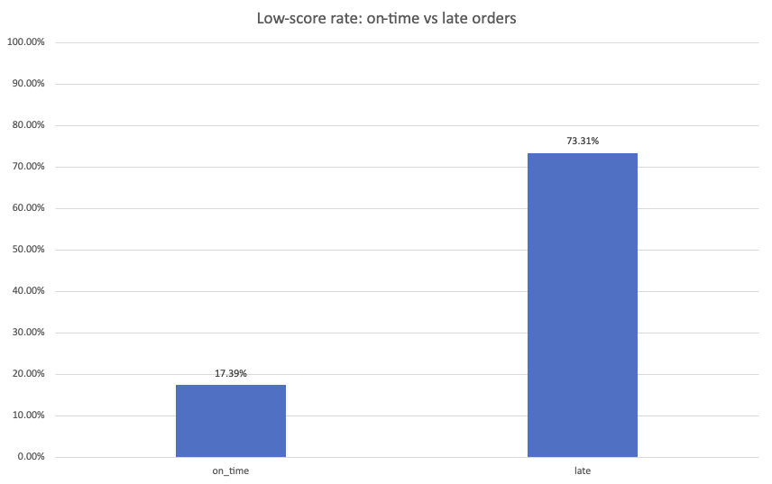
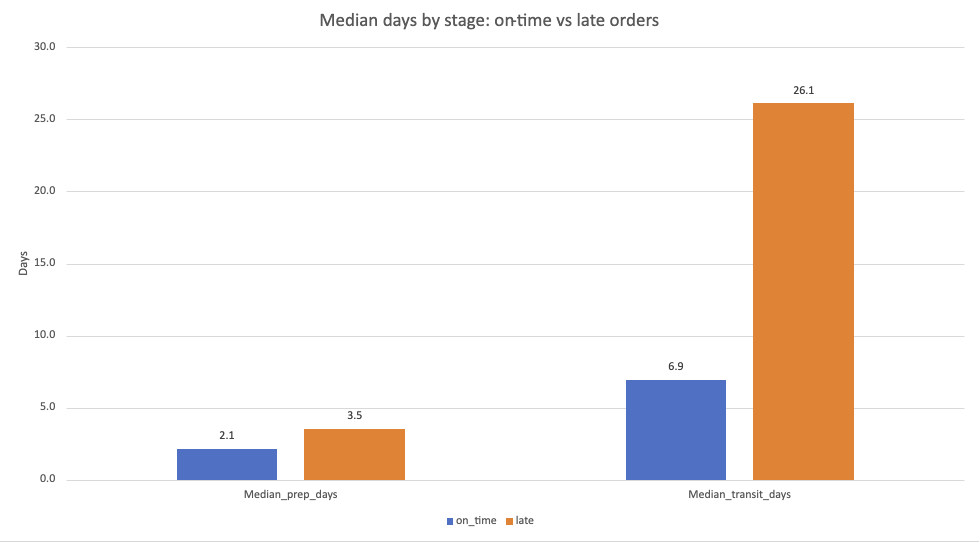

# Do late deliveries drive low review scores?

An operations analysis of 95,636 Olist orders, using PostgreSQL and Excel.

## TL;DR

- **Late orders get far more low scores.** 73.3% of late orders received a 1 to 3 star review, versus 17.4% of on-time orders (about 4.2 times higher, a gap of 55.9 percentage points).
- **The delay sits in the transit stage, not in seller prep.** For late orders the median transit time is 19.2 days longer than for on-time orders. The median prep time is only 1.4 days longer.
- **This is an association, not proof of cause.** The data shows where orders are slow, not why.

## Business question

Written as if for an operations lead: *Do orders that arrive after the estimated delivery date get worse reviews than orders that arrive on time? If yes, is the delay in seller preparation (order to carrier handoff) or in transit (carrier handoff to customer)?*

If the delay is in transit, the next step is to talk with the logistics partners. If it is in prep, the next step is to talk with sellers. If lateness and low scores turn out to be unrelated, the low scores need a different explanation.

## Data

- [Brazilian E-Commerce Public Dataset by Olist](https://www.kaggle.com/datasets/olistbr/brazilian-ecommerce) on Kaggle, licensed [CC BY-NC-SA 4.0](https://creativecommons.org/licenses/by-nc-sa/4.0/). Orders were placed between September 2016 and October 2018.
- I used two of the nine tables: `orders` (99,441 orders) and `order_reviews` (99,224 reviews).
- **The raw data and any order-level exports are not in this repo.** To reproduce, download the dataset from Kaggle and load the CSV files into PostgreSQL.

## Definitions (set before looking at results)

| Term | Definition |
|---|---|
| Late | Delivered date is later than the estimated delivery date, compared by date. The estimate has no time of day, so anything delivered on the estimated day counts as on time. |
| Low score | A review score of 1, 2 or 3 stars |
| One review per order | 547 orders have more than one review. I keep the lowest score. |
| Prep stage | Order placed to handed to the carrier |
| Transit stage | Handed to the carrier to delivered to the customer |
| Decision rule | Clearly related if the late group's low-score rate is above 50% or at least twice the on-time rate. Not related if the gap is under 5 percentage points. In between is worth a closer look. These thresholds are my own judgment, not an industry standard. I wrote them down before seeing any results. |

## Approach

1. **Explore and clean** the two tables (nulls, duplicates, impossible timestamps).
2. **Exclusion funnel**, so every dropped order is accounted for:

   | Step | Orders left | Removed |
   |---|---|---|
   | All orders | 99,441 | |
   | Status is delivered | 96,478 | 2,963 |
   | Has a delivered-to-customer date | 96,470 | 8 |
   | Has a handed-to-carrier date | 96,469 | 1 |
   | Timestamps in a possible order | 96,281 | 188 |
   | Has a review (final population) | **95,636** | 645 |

3. **Merge** orders and reviews on `order_id`, one row per order.
4. **Compare** the low-score rate of on-time and late orders, then compare the median prep and transit days for each group.
5. **Validate** (see below) and write down the limits.
6. **Rebuild the summary in Excel** with a pivot table and formulas (`COUNTIFS`, `SUMIFS`, `MEDIAN` with `FILTER`) as an independent cross-check. The workbook is not published because it holds order-level data.

## Results

| Group | Orders | Low-score orders | Low-score rate |
|---|---|---|---|
| On time | 89,258 | 15,518 | 17.39% |
| Late | 6,378 | 4,676 | 73.31% |

| Stage | Median days, on time | Median days, late | Difference |
|---|---|---|---|
| Prep | 2.1 | 3.5 | 1.4 days (about 1.6x) |
| Transit | 6.9 | 26.1 | 19.2 days (about 3.8x) |





Both of my "clearly related" conditions were met. The gap is far above the 5 point line, and the late group's rate is above 50%.

## Recommendations

1. **Look at the transit stage first.** Ask the logistics partners where the slowest orders get stuck (for late orders, the 90th percentile of transit time is about 44.6 days, versus 15.3 for on-time). The trade-off is that prep gets less attention for now, and finding the cause needs time with the partners.
2. **Read the low-score reviews for late orders** and sort the reasons (slow delivery, product problem, service). The numbers show where orders are slow but not why, so this is how to get from the numbers to a cause. The trade-off is that not every review has text, and the text is in Portuguese, so translation adds error.
3. **Leave the prep stage for later.** It is only 1.4 days slower for late orders, so the return on fixing it first is smaller. If seller data is added later, check whether slow prep is concentrated in a few sellers.

I do not give an expected improvement percentage, because this analysis cannot estimate one.

## Validation

- **Reconciliation:** on-time plus late equals the final population (89,258 + 6,378 = 95,636), and the final population plus every excluded group equals all orders (99,441).
- **One row per order:** `COUNT(*)` equals `COUNT(DISTINCT order_id)` (95,636), so multi-review orders are not double counted.
- **Hand check:** I picked 10 orders (2 clearly on time, 2 clearly late, 4 delivered on the estimated day, 2 delivered one day after) and classified them by hand from the raw CSV. All 10 matched the SQL, including an order delivered 32 minutes after midnight on the estimated day.
- **Independent recount:** the group sizes, low-score rates and median days were recomputed outside the database from the raw CSV files. They match the SQL and the Excel summary.
- **Sensitivity test:** using each order's last review instead of its lowest gives 73.31% for late orders (unchanged) and 17.34% for on-time orders (was 17.39%). The conclusion does not change.
- **Worst case for orders with no review:** 645 delivered orders have no review. Even if all of them had been added to the late group with no low score, the late rate would still be 66.6%, about 3.8 times the on-time rate.

## Limitations

1. The data covers 2016 to 2018 in Brazil. It says nothing certain about today or about other markets.
2. It shows where orders are slow, not why (distance, carrier, peak season and seller behavior are all possible).
3. **Association, not cause.** Low scores can also come from product defects or wrong items, and a third factor such as remote delivery areas could raise both lateness and low scores.
4. Comparing by date makes the on-time group slightly worse than it should be (an order delivered at 11:50 pm on the estimated day counts as on time). That makes the true gap slightly larger than reported, so this choice is conservative.
5. The thresholds and the definition of a low score (1 to 3 stars) are my own choices.
6. Only two tables were used. Product category, seller, customer location and price were not controlled for.

The full list, with the effect of each limit on the conclusion, is in [`docs/validation-and-limitations.md`](docs/validation-and-limitations.md).

## Repo structure

```
sql/
  01_clean_and_merge.sql          cleaning rules, merge, exclusion funnel
  02_main_analysis.sql            low-score rate by group, prep and transit days
  03_sensitivity_last_review.sql  same analysis using each order's last review
images/                           the two charts
docs/validation-and-limitations.md
```

To reproduce: download the dataset from Kaggle, load the nine CSV files into PostgreSQL (keep zip code prefixes as text and the date columns as timestamps), then run the three SQL files in order.

## How I used AI

I used Claude (Anthropic) as a coach. The rule was that I write first and Claude reviews.

- **Mine:** the business question, the definitions and thresholds, all the cleaning, merge and analysis SQL, the ranking query for the last review, the Excel formulas, and the decisions about what to exclude.
- **Claude's:** reviewing my code and explaining each mistake, checking my numbers with an independent recount outside the database, and drafting the wording of some limitations and recommendations, which I reviewed and changed. Claude also wired my ranking query into the full sensitivity test (`03_sensitivity_last_review.sql`).
- **Checks:** every number was confirmed three ways (SQL, an independent recount, Excel).

## Credits

Data: Olist, *Brazilian E-Commerce Public Dataset by Olist*, Kaggle, CC BY-NC-SA 4.0. This project is for learning and a portfolio, not commercial use.
